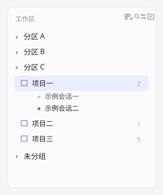
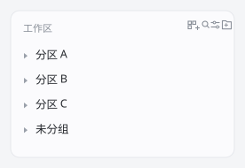

# dsh-workspace-groups · 工作区分区

把 DSH 侧边栏里零散的工作区收进**可折叠的分区**，形成 `分区 → 工作区 → 会话` 三层结构。

| 展开一个分区 | 收起后只剩分区 |
| --- | --- |
|  |  |

## 它做了什么

DSH 自带的侧边栏把工作区平铺成一列（或按真实路径做「工作区树」）。本插件把**浏览区域的单占位**（slot `sidebar.workspaces`）换成自己的分组浏览器：

- **分区（group）**：自命名、可折叠、可排序的容器，一个工作区只属于一个分区。折叠时只显示 `› 分区名`，展开后显示文件夹图标。
- **工作区（workspace）**：仍是 DSH 原生工作区对象，点击展开显示它的会话；悬停出现 `+`（在该工作区新建会话）与 `⋯`（重命名 / 移入分区 / 移出分区 / 删除）。
- **会话（session）**：展开后按最近更新排序，带状态点（运行中 / 未读完成 / 等待回答 / 空闲），点击即打开。
- **未分组**：没被收进任何分区的工作区自动落入「未分组」，不会丢。
- **拖拽整理**：把工作区行拖到任意分区标题上即可改归属；`⋯` 菜单里也能精确移动。
- **添加工作区**：右上角文件夹按钮走 DSH 原生目录选择器（`ctx.remote.directoryPicker.pick`），选完自动注册工作区并开一个新会话；拿不到原生选择器时退化为「输入绝对路径」对话框。
- **持久化**：分区结构存浏览器 `localStorage`（键 `dsh.workspace.groups.v1`），刷新页面、换会话都在。工作区本身仍由 DSH 主机存储。

## 安装

Web 版（`dsh web`，profile 名 `web`）：

```powershell
dsh plugin --profile web add link:E:/个人代码/dsh-group-workspace
```

桌面版（Electron，profile `desktop`）由应用自身管理，用应用内「插件」面板从本地目录安装，或按下节手动同步。

装好后 `~/.dsh/profiles/<profile>/package.json` 的 `dsh.profile.bundles` 会多出 `dsh-workspace-groups`。客户端 bundle 是预构建的单文件（`client/client.js`），**没有构建步骤**；重载页面即可生效，插件管理面板里禁用再启用也能即时重载。

## 卸载

```powershell
dsh plugin --profile web remove dsh-workspace-groups
```

卸载后侧边栏自动回到官方浏览器；分区数据留在 localStorage，重新装回来还在。

## 实现要点

| 关注点 | 做法 |
| --- | --- |
| 占位接管 | `sidebar.workspaces` 是 `kind: "single"` 的 slot，`entriesOfSlot` 只保留第一个条目，而 `register()` 会按 `priority` 升序排序。插件以 `priority: -10000` 注册，直接排在官方 `WorkspaceBrowser` 之前，不改动宿主任何内部结构。 |
| 数据来源 | 全部用 DSH 的公开根 hook：`useWorkspaces`（工作区投影 + 归档集）、`useSessions`（会话目录）、`useSessionStatus`（运行 / 未读 / 待回答）。 |
| 动作 | `ctx.get('uiWorkspace')` 的 `startSession` / `openSession` / `archiveSession`，`ctx.get('workspaces')` 的 `create` / `rename` / `delete`，目录选择走 `ctx.remote.directoryPicker.pick`。 |
| 状态 | `@deepseek-ai/dsh-client-store` 的 `defineStore`（immer + localStorage 持久化），通过 slot 注册的 `store` 句柄把 `useStore` / `actions` 注入组件。 |
| 容错 | 组件自带 error boundary：渲染出错时只在本区域显示错误，不会让 slot 条目被弃用（否则整个浏览区会空掉）。 |

## 已知限制

- 会话行的官方扩展位（置顶 / 归档按钮、计划任务角标、悬浮卡片）属于内置浏览器的子 slot，替换占位后不再渲染；置顶 / 归档仍在「⋯」菜单里可用。
- 搜索、归档过滤、手动排序、工作区树视图属于内置浏览器；本插件用分区替代，不做重复实现。
- 分区结构是浏览器本地数据，不是主机数据；换机器 / 换浏览器不会同步（可按需扩展成主机存储）。
- 窄侧边栏（rail）下只显示各分区的快捷图标，完整列表需展开侧栏。

## 目录

```
dsh-group-workspace/
├─ package.json          # dsh.bundle.patch + dsh.client.inject 声明
├─ cordis.patch.yml      # 把本插件插入 profile 的 loader 层
├─ lib/index.js          # 主机侧入口（本插件无主机逻辑，仅占位 + 日志）
├─ client/client.js      # 客户端 bundle（分组浏览器 + 占位接管）
├─ docs/                 # 预览图
└─ tools/                # 本地验证脚本（截图 / DOM 探针 / 交互回归），不随插件发布
```
